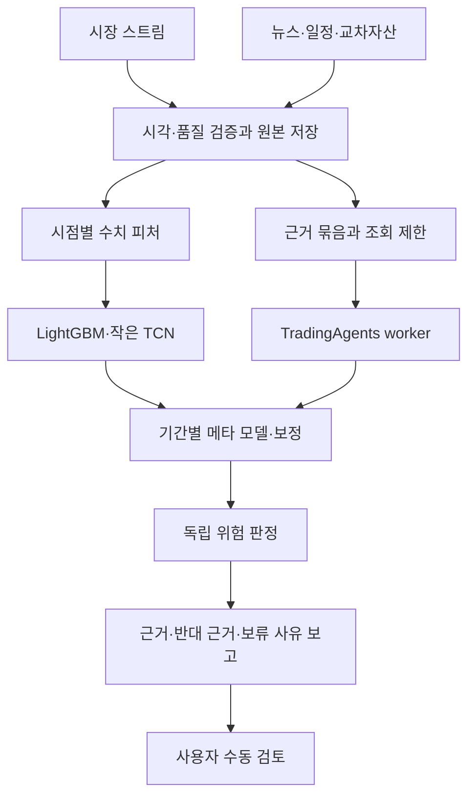
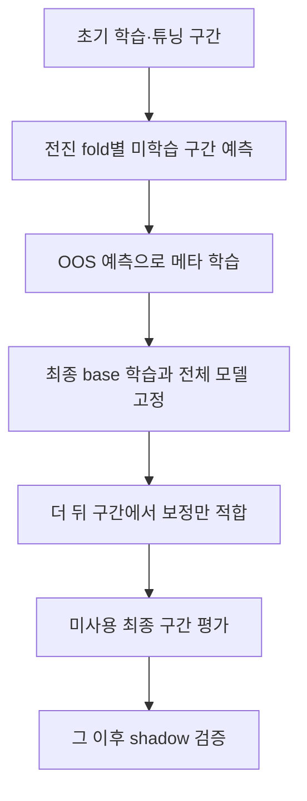

# AQE 신규 구축 설계도 — 수치 모델과 TradingAgents의 통합

문서 버전: 1.0 · 작성 기준: 2026-11-11 KST · 용도: Claude 구현의 기준 명세

기준 문서: `AQE_TradingAgents_Integration_Prompt_KO.md`의 빈 프로젝트 구축판. 기준 파일 SHA-256: `64b4441541e53fbcfde36cdd2f81e181808cdd53d7259c526e2d1f015412c403`.

이 문서는 구현·학습·성능 검증이 완료됐다는 보고서가 아니다. 기존 AQE 코드·학습 가중치·데이터·AWS 자원이 없다는 전제에서, 무엇을 가져오고 무엇을 새로 만들며 어떤 순서로 검증할지를 고정하는 설계도다. 기존 기준 문서를 교체하거나 과거 파일의 존재를 요구하지 않는다.

## B01. 만들 시스템과 범위

구축할 시스템은 **LightGBM + 작은 인과적 TCN + TradingAgents 기반 근거 분석 + 시간 순서 메타 모델 + 독립 위험관리 코드**를 갖춘 하나의 AQE 프로젝트다.

TradingAgents는 이 조합에서 근거 기반 LLM 분석을 담당한다. 별도의 LLM 봇과 TradingAgents 봇을 각각 완성한 뒤 연결하는 구조가 아니다. 단순 근거 기반 LLM은 TradingAgents의 효과를 비교하기 위한 교체 가능한 대조군이다.

| 요구 ID | 구현 요구 | 완료를 판정할 증거 |
|---|---|---|
| R01 | 빈 프로젝트에서 새로 구축 | 환경 진단, 의존성 잠금, 실행 가능한 CLI |
| R02 | 공식 소스와 자체 구현 구분 | 출처·버전·라이선스·수정 내역 기록 |
| R03 | 암호화폐 공개 데이터의 실제 수집·보존 | 원본, 수집 시각, 품질 상태, 재생 가능 기록 |
| R04 | 가격·체결·호가·OI·이벤트의 시간 정합성 | as-of 조회와 미래 데이터 차단 테스트 |
| R05 | LightGBM을 실제 데이터로 학습 | 데이터 manifest, 학습 로그, 모델 파일 |
| R06 | 작은 TCN을 별도 학습 | 인과성 테스트, 체크포인트, OOS 예측 |
| R07 | 실제 TradingAgents 그래프 연결 | 고정 SHA, 어댑터, 오프라인/실연결 결과 구분 |
| R08 | 시간 순서 OOS 기반 메타 학습·보정 | 분할 manifest, 누출 검사, 독립 평가 |
| R09 | LLM과 분리된 위험 판정 | 코드 규칙, 판정 이유, 실패 시 차단 |
| R10 | 롱·숏 및 여러 예측 기간 지원 | 기간별 별도 예측·평가·보고 |
| R11 | 비용을 포함한 비교 검증 | 동일 조건 대조군, 실험 장부, 미사용 최종 구간 |
| R12 | 재시작·운영·인수인계 가능 | BUILD_STATUS, 복구 테스트, 운영 문서 |

목적은 방향성·진입 근거·반대 근거·함정 가능성을 사람이 검토하도록 돕는 것이다. 초기 런타임은 `research`, `replay`, `shadow`만 허용한다. 자동 주문, 거래소 주문 API, 자동 레버리지, 실거래 승인 버튼은 구현 범위에서 제외한다. `approval_required=true`, `execution_enabled=false`를 출력 계약으로 고정한다.

AWS 24시간 운영을 목표로 하지만, 이번 구현에서 유료 자원을 실제 생성하거나 배포하지 않는다. 로컬 실행과 클라우드 배포 준비물을 단계적으로 만든다. 사용자의 Windows 환경·메모리·디스크·Docker 설치 여부는 진단으로 확인하며 과거 환경을 현재 사실로 단정하지 않는다.

## B02. GitHub 소스, 재사용 코드, 학습 대상

**공식 구현이 공개되어 있다는 것과 암호화폐 예측용 가중치가 준비되어 있다는 것은 다르다.** 아래 중 LightGBM·TCN·메타 모델은 우리 데이터로 새로 학습한다. TradingAgents는 사전 학습된 LLM을 호출하는 프레임워크다.

| 구성 | 공식 소스 | 실제로 재사용할 것 | AQE에서 새로 만들 것 | 별도 학습 |
|---|---|---|---|---|
| LightGBM | [현재 공식 저장소](https://github.com/lightgbm-org/LightGBM), [Microsoft 기존 주소](https://github.com/microsoft/LightGBM) | Python 패키지의 트리 학습·추론 기능 | 암호화폐 피처, 타깃, 분할, 학습·추론 래퍼 | 필요 |
| 작은 TCN | [locuslab/TCN](https://github.com/locuslab/TCN), [PyTorch](https://github.com/pytorch/pytorch) | 저자 공개 인과적 합성곱·잔차 블록 설계와 PyTorch 연산 | 작은 네트워크, 정규화, 데이터 로더, 학습 루프 | 필요 |
| 근거 기반 에이전트 | [TauricResearch/TradingAgents](https://github.com/TauricResearch/TradingAgents) | 분석가·토론·위험 토론의 실제 그래프 | 암호화폐 근거 공급, 시각 제한, 구조화 출력, 격리·비용 제어 | 초기에는 자체 LLM 학습 없음 |
| 시간 순서 메타 모델 | [scikit-learn](https://github.com/scikit-learn/scikit-learn) | 규제 로지스틱 회귀 등 검증된 추정기 | 전진 OOS 데이터 생성, 라벨 중첩 제거, 기간별 결합·보정 | 필요 |
| 독립 위험관리 | 별도 범용 모델 저장소를 채택하지 않음 | 표준 수학·자료형·거래소 규칙 | `src/aqe/risk/`의 결정적 판정 코드 | 학습하지 않음 |
| 선택적 로컬 LLM | [Qwen3 공식 코드](https://github.com/QwenLM/Qwen3), [Qwen3-8B 가중치](https://huggingface.co/Qwen/Qwen3-8B) | 선택한 모델의 공개 가중치 | 제공자 어댑터와 실제 품질·자원 검증 | 초기에는 추론만 |

LightGBM의 Microsoft 주소는 조사 시점에 `lightgbm-org/LightGBM`으로 연결됐다. 기존 출처를 지우지 않고 현재 정식 주소를 함께 기록한다. TCN은 저자 연구 코드이며 검증된 코인 수익 모델이라는 뜻이 아니다. 시간 순서 메타 모델이라는 완제품을 내려받는 것도 아니다. 시간 분할과 학습 데이터 구성은 AQE가 책임진다.

LightGBM·TCN은 MIT, scikit-learn은 BSD-3-Clause로 표시된 공식 저장소를 확인했다. 실제 고정한 버전과 복사·수정한 파일의 라이선스를 다시 기록한다. 다른 프로젝트나 LLM 가중치의 라이선스를 이 표에서 추정하지 않는다. 관련 파일은 `docs/THIRD_PARTY_SOURCES.md`, `THIRD_PARTY_NOTICES.md`, `docs/UPSTREAM_PATCHES.md`에 남긴다.

LightGBM·scikit-learn·PyTorch는 의존성으로 설치하며 전체 저장소를 합치지 않는다. TCN은 공식 구현을 참고해 작은 모듈로 작성하고, 원문 코드를 복사했다면 원래 고지와 변경 내역을 유지한다. TradingAgents는 Git SHA를 고정한 의존성 또는 별도 worker 환경으로 사용한다. 업스트림 수정이 필요하면 작은 패치와 그 이유를 관리한다.

LLM 제공자는 설정으로 선택한다. 구현자가 임의의 유료 모델을 호출하거나 로컬 8B 모델이 현재 PC에 적합하다고 가정하지 않는다. `provider`, `model_id`, 실제 반환 모델명, 프롬프트 해시, 온도, 사용량·비용 추정 근거를 기록한다. API 키가 없어도 나머지 계층의 구현과 학습은 계속할 수 있어야 한다.

## B03. 전체 구조와 책임 경계

초기 형태는 모듈형 단일 프로젝트다. 빠른 수치 추론과 느린 LLM worker만 프로세스로 분리한다. LLM timeout이 수집이나 수치 모델을 멈추게 하지 않는다. 첫 버전에 Kafka·여러 마이크로서비스·분산 학습을 도입하지 않는다.

| 모듈 경로 | 책임 | 다른 계층에 넘기는 것 |
|---|---|---|
| `src/aqe/contracts/` | 입력·출력 자료형, enum, 스키마 버전 | 검증된 계약 |
| `src/aqe/config/` | 환경·실험·모델·수집 설정과 검증 | 해시가 있는 실행 설정 |
| `src/aqe/ingestion/` | Binance 수집, L2 복원, 외부 이벤트 어댑터 | 원본 이벤트와 품질 사건 |
| `src/aqe/storage/` | 원본 파일, Parquet, PostgreSQL/TimescaleDB, manifest | 재생·as-of 조회 |
| `src/aqe/features/` | 인과적 피처 계산, 레짐·흐름·이벤트 피처 | FeatureSnapshot |
| `src/aqe/datasets/` | 타깃, 전진 분할, 라벨 성숙·중첩 제거 | DatasetManifest와 학습 묶음 |
| `src/aqe/models/` | LightGBM·TCN 학습, 저장, 추론 | ModelPrediction |
| `src/aqe/context/` | 근거 묶음, 단순 LLM/TradingAgents 어댑터, worker | ContextAssessment |
| `src/aqe/ensemble/` | OOS 결합, 메타 학습, 보정, 불일치 측정 | 기간별 EnsemblePrediction |
| `src/aqe/risk/` | 독립 규칙, 상태·비용·포트폴리오 검사 | RiskDecision |
| `src/aqe/evaluation/` | 예측·비용·가상 운용 평가, 실험 장부 | 평가 보고서 |
| `src/aqe/reporting/` | 사람용 Markdown/JSON 보고 | 원본 판정을 바꾸지 않는 설명 |
| `src/aqe/cli/` | 수집·학습·검증·분석 명령 | 종료 코드와 실행 기록 |

루트에는 `pyproject.toml`, 의존성 lock, `.env.example`, `configs/`, `tests/`, `docs/`, `deploy/`, `BUILD_STATUS.md`, `README.md`를 둔다. 로컬 실행 데이터는 설정한 `data_root`, 모델은 `artifact_root`에 저장하고 Git에 넣지 않는다. 사용자 드라이브 경로를 코드에 하드코딩하지 않는다.

Python 3.12를 첫 호환성 검증 후보로 삼는다. 실제 설치 결과로 lock을 만든다. TradingAgents와 학습 라이브러리 의존성이 충돌하면 core와 context-worker 환경을 나누되 JSON 계약을 유지한다. 맞지 않는 버전을 강제 설치하고 성공했다고 기록하지 않는다.

## B04. 시간·자산·가용성 계약

모든 시각은 timezone-aware UTC, 저장·직렬화는 ISO 8601 UTC로 통일한다. 거래소 밀리초 원본은 별도 보존한다. 예측의 결합 키는 최소 `(venue, market_type, instrument_id, as_of, horizon_seconds, feature_profile, schema_version)`이다. BTC 현물·USDT 무기한·만기 선물을 같은 자산으로 합치지 않는다.

| 시각 필드 | 의미 |
|---|---|
| `event_time` | 시장 사건·체결 등이 일어난 원천 시각 |
| `published_at` | 뉴스·지표가 최초로 공개된 시각; 알 수 없으면 null |
| `received_at` | 우리 수집기가 실제로 받은 시각 |
| `available_at` | 해당 버전의 데이터가 해당 실행 환경에서 사용 가능해진 시각 |
| `as_of` | 이 분석이 사용할 수 있는 정보의 마감 시각 |
| `generated_at` | 계산이 끝난 실제 시각 |
| `valid_until` | 그 결과를 재사용할 수 있는 만료 시각 |

판단 시점에는 `available_at <= as_of`인 버전만 선택한다. 수정된 거시 지표·기사·온체인 라벨은 새 버전으로 보존한다. 미래에 수정된 값을 과거로 덮어쓰지 않는다. 캔들은 완성 시각과 가용 시각이 지난 뒤에만 사용한다. 느린 결과를 `generated_at` 대신 오래된 `as_of`로 숨기지 않는다.

각 데이터 묶음은 `LIVE_CAPTURE`, `VERIFIED_ARCHIVE`, `ASSUMED_LATENCY_REPLAY`, `SYNTHETIC_FIXTURE` 중 하나의 provenance를 갖는다. 과거 캔들을 오늘 다운로드했다면 실제 과거 수신 시각을 가진 데이터가 아니다. 공개 시각+가정 지연으로 재생할 수 있지만 이를 명시하고 엄격한 실시간 검증과 구분한다. fixture는 기능 시험 전용이다.

초기 대상은 Binance USDⓈ-M의 BTCUSDT·ETHUSDT 무기한 선물이다. 우선 BTCUSDT 하나로 수직 경로를 완성한 뒤 확장한다. 5분 봉으로 피처를 만들고 5분마다 갱신하되, 예측 기간은 우선 **1시간과 24시간을 별도 모델**로 운용한다. 5분·72시간 예측은 설정 확장 후보이며 각각 새로운 타깃·평가·artifact가 필요하다. 여러 기간을 같은 방향 투표로 섞지 않는다.

## B05. 데이터 수집·보존 설계

### B05.1. 먼저 가능한 데이터와 앞으로 쌓아야 하는 데이터

| 피처 프로필 | 필요한 실제 데이터 | 당장 가능한 일 | 할 수 없는 주장 |
|---|---|---|---|
| `ohlcv_v0` | 완성된 OHLCV와 품질 메타데이터 | 공개 이력으로 수치 모델 파이프라인 구축·기초 평가 | 호가·CVD·고래 정보까지 반영됐다는 주장 |
| `flow_v1` | v0 + 연속 복원 L2, 체결, OI·funding 관측 | 지금부터 수집, 충분히 쌓이면 별도 학습 | 과거 L2를 캔들로 복원했다는 주장 |
| `context_v1` | 뉴스·일정·교차자산의 시점별 근거 | 근거 수집·worker·전향 검증 | 오늘 검색한 기사로 완전한 과거 검증을 했다는 주장 |

`flow_v1`의 필수 피처가 없으면 `ohlcv_v0` artifact로 명시적 전환한다. 같은 모델 입력을 0으로 채워 정상으로 표시하지 않는다. 각 모델과 메타 모델은 입력 프로필·순서·단위·필수값·정규화 해시를 검사한다. 프로필이 다르면 별도 학습·등록한다.

### B05.2. 원천과 초기 어댑터

Binance 공개 REST/WS를 먼저 구현한다. HTTP timeout·지수 backoff·jitter·요청 한도·재연결·취소 가능한 종료를 제공한다. 공식 최신 문서에 따른 경로를 설정으로 관리한다. 조사 시점 문서에는 depth는 `/public`, aggTrade·markPrice·kline은 `/market` 계열로 분리되어 있었다. 구형 단일 WS 경로를 복사해 전부 연결됐다고 가정하지 않는다.

| 입력 | 초기 수집 방식 | 주의점 |
|---|---|---|
| OHLCV | 공개 REST backfill + 완성 봉 수집 | 누락·중복·종가 확정 여부 확인 |
| L2 | depth WS + REST snapshot | 시퀀스 연속성이 깨지면 무효화·재동기화 |
| 체결/CVD | aggTrade WS, 원본 ID·매수자 maker 여부 보존 | 집계 체결 기반이며 모든 원시 체결 정보와 같지 않음 |
| OI | 현재값 polling + 가능한 기간의 통계 이력 | 역사 제공 기간의 한계와 빈 구간 보존 |
| funding·mark | 공개 원천별 관측·이력 | 예상 funding과 확정 funding을 구분 |
| 거시·실적 일정 | 제공자 인터페이스 + 출처 확인된 파일 import | 일정 변경·발표치 수정·시간대 버전 관리 |
| 뉴스·X 등 소셜 | 허용된 API 또는 검증 가능한 import | 유료·권한 미확보 상태는 missing, 원문 권한 준수 |
| Nasdaq 등 교차자산 | 거래시간을 아는 제공자 인터페이스 | 휴장·지연 시세·출처별 시간 정합성 |
| 온체인·공개 지갑 | 검증된 공급자 선택 후 확장 | 확인 블록·수집 시각·지갑 라벨 불확실성 |

OI 통계 공식 문서는 최근 1개월 제공으로 안내되어 있었다. 현재 OI를 호출해 과거 이력을 만들어내지 않는다. 미확보 이벤트·소셜·교차자산 커넥터는 인터페이스와 명시적 missing 결과까지 구현하고, 실데이터 연결 완료와 구분한다.

### B05.3. 호가 복원과 흐름 피처

L2 상태는 `DISCONNECTED → BUFFERING → SNAPSHOT_SYNC → SYNCED`로 진행하며 시퀀스 단절 시 `DESYNCED → BUFFERING`으로 복구한다. 다음 규칙은 USDⓈ-M 공식 로컬 오더북 절차 기준이며 Spot 절차와 혼용하지 않는다.

1. WS 이벤트를 버퍼링하면서 REST snapshot의 `lastUpdateId`를 얻는다.
2. `u < lastUpdateId`인 이벤트를 버리고 첫 적용 이벤트가 `U <= lastUpdateId <= u`를 만족하는지 확인한다.
3. 이후 이벤트의 `pu`가 직전 `u`와 같은지 검사한다. 불일치는 즉시 invalid 및 snapshot 재시작이다.
4. 수량은 절대값으로 반영하고 0 수량은 삭제한다. 존재하지 않는 가격 삭제는 정상 사례로 처리한다.
5. 재연결 이후 재동기화 전의 L2 피처는 사용하지 않는다. 재생 시험에도 같은 로직을 사용한다.

체결 CVD는 aggressor 방향과 거래량으로 계산한다. aggTrade에서 buyer-maker가 true이면 매도 aggressor, false이면 매수 aggressor로 검증한다. 누적 시작점·리셋·누락을 기록한다. 가격은 가능한 정수 tick 또는 Decimal로, 분석 피처는 검증 후 float로 변환한다.

호가 불균형, spread, depth, 체결 압력, 벽 유지·취소·체결 패턴, 가격의 흡수 반응을 관측 피처로 만들 수 있다. 다만 공개 L2로 특정 세력의 계좌·보유 포지션·의도를 확정하지 않는다. spoofing·매집·함정은 관측 패턴의 경고 이름이며 사실 라벨로 자동 생성하지 않는다. 소셜 계정 주장과 검증된 거래 기록도 구분한다.

### B05.4. 저장과 복구

원본 WS/REST 응답은 append-only 압축 파일로 남기고, 정규화 데이터는 날짜·원천·자산별 Parquet와 manifest로 관리한다. 작은 파일을 이벤트마다 만들지 않고 크기·시간 기준으로 회전한다. PostgreSQL/TimescaleDB에는 요약 시계열, 데이터 품질, 작업·모델 registry, 예측·판정 로그를 저장한다. 모든 틱을 무조건 일반 테이블에 넣지 않는다.

초기에는 로컬 파일 + 새 PostgreSQL/TimescaleDB 구성을 사용하고, DB가 준비되지 않은 환경에서도 fixture 기반 단위 시험은 가능하게 한다. 원본·정규화·artifact 저장소는 인터페이스로 분리해 나중에 S3로 옮길 수 있게 한다. 수집 전달은 at-least-once + event ID 중복 제거이며 exactly-once를 주장하지 않는다.

최소 테이블: `ingestion_health`, `market_bars`, `flow_summaries`, `oi_observations`, `funding_observations`, `evidence_versions`, `scheduled_event_versions`, `context_jobs`, `context_assessments`, `model_registry`, `predictions`, `risk_decisions`, `experiment_runs`. 시계열 테이블의 중복 방지 키에는 자산·원천 시각·원천 ID를 포함한다. 대용량 본문은 파일 위치·해시로 참조할 수 있다.

체크포인트는 마지막 확정 원천 ID·시각을 원자적으로 갱신한다. 종료 전 flush, 재시작 시 중복 제거, 디스크 여유·수집 지연·시계 오차·실패율을 감시한다. 데이터 삭제·retention은 사용자 설정 없이는 자동 실행하지 않는다.

## B06. 주요 데이터 계약

계약은 Pydantic 등으로 엄격하게 검증하고 JSON Schema를 내보낸다. 아래는 최소 필드이며 실제로 선택한 필드 이름은 문서·코드·시험에서 동일해야 한다.

| 계약 | 필수 핵심 필드 |
|---|---|
| `FeatureSnapshot` | identity 키, `as_of`, `feature_profile`, ordered feature values, missing mask, source watermarks, quality, manifest hash |
| `DatasetManifest` | data range, provenance, feature schema/hash, horizon, label definition, fold boundaries, purge rules, source hashes |
| `ModelPrediction` | identity, model/artifact ID, train-label cutoff, `as_of`, horizon, `p_down/p_neutral/p_up`, optional expected return, generated/expiry times, status |
| `EvidenceItem` | ID, source URL/ID, source kind, content hash, event/publication/receipt/availability times, revision, verification status |
| `EvidenceBundle` | asset scope, `as_of`, selected evidence IDs, calendar snapshot, source health, bundle hash |
| `ContextAssessment` | identity, backend/upstream/model/prompt IDs, evidence IDs, claims/counterclaims, event flags, coverage, temporal scope, contextual rating, status, usage |
| `EnsemblePrediction` | identity, base/context IDs, meta/calibrator IDs, class probabilities, disagreement, OOD status, missingness, generated/expiry times |
| `RiskDecision` | analysis ID, ruleset hash, pass/fail/unknown per rule, disposition, reasons, portfolio status, approval/execution flags |

확률은 유한한 실수이고 각각 0~1, 합은 허용 오차 내 1이어야 한다. 클래스 순서는 항상 `[down, neutral, up]`이다. 확률과 LLM의 표현상 확신도를 같은 필드에 넣지 않는다. 기대수익률·변동성은 비율 단위, spread·fee는 `*_bps`, 수량은 base/quote 단위를 명시한다. 알 수 없는 값은 null과 원인을 기록한다.

`ContextAssessment.status`는 `OK`, `PARTIAL`, `MISSING`, `TIMEOUT`, `INVALID`, `UNSUPPORTED`를 사용한다. `temporal_scope`는 `INTRADAY_ASOF_VERIFIED`, `DAILY_CONTEXT_ONLY`, `UNVERIFIED`를 구분한다. 근거 없음은 중립 의견이 아니다. TradingAgents의 BUY/HOLD/SELL 유사 등급은 `contextual_rating`이며 확률·주문·포트폴리오 승인으로 취급하지 않는다. `REVIEW`는 데이터나 판단을 추가 검토해야 한다는 별도 상태다.

artifact에는 학습 데이터 manifest, 피처 프로필, 타깃·기간, 학습 라벨 최종 시각, 코드/의존성/설정 해시, seed, 정규화기, 클래스 순서, 검증 상태를 함께 저장한다. 모델 파일만 있으면 운영 가능하다고 판단하지 않는다.

## B07. 수치 모델 설계와 실제 학습

### B07.1. 타깃과 피처

초기 공통 타깃은 기간별 3클래스 방향이다. `as_of=t`의 완성된 가격 `P_t`와 `t+h`의 완성 가격으로 `r=log(P_(t+h)/P_t)`를 정의한다. `r > b_t`는 up, `r < -b_t`는 down, 나머지는 neutral이다. `b_t`는 과거 변동성과 사전에 고정한 비용 가정으로 결정하며, 그 계수는 훈련·튜닝 구간에서만 정한다. 피처 생성에는 미래 수익률이 들어가지 않는다. 빠진 목표 시점·비정상 캔들·불완전 라벨은 제외한다.

이 타깃은 방향 예측용이며 실제 체결 손익과 같지 않다. 평가는 다음 실행 가능한 가격·지연·수수료·slippage·funding을 별도 반영한다. `p_up`만으로 기대수익을 계산하지 않는다. 수익 크기를 추정할 별도 회귀/분포 모델 또는 훈련 구간에서만 추정한 조건부 수익분포가 없으면 EV는 `unknown`이다.

v0 피처는 과거 수익률·실현 변동성·거래량 변화·캔들 범위·추세·과거 drawdown·시간 정보 등 작은 집합으로 시작한다. 장기 과거 추세는 과거 창으로 계산한다. v1에서 CVD·OI 변화·funding·호가/체결 흐름을 추가한다. 롤링 통계·스케일러·특징 선택·결측 처리의 학습 가능한 상태는 훈련 구간에서만 적합한다.

### B07.2. LightGBM

기간별 multiclass 모델을 기본으로 한다. 피처·타깃·기간이 같은 데이터로 학습·검증·추론 경로를 공유한다. 작은 탐색 예시는 `num_leaves=31`, `max_depth=6`, `learning_rate=0.05`이며 초기 후보일 뿐 권장 수익 설정이 아니다. early stopping은 시간상 뒤의 별도 검증 구간으로 수행한다. 최소 leaf 크기·불균형·표본 가중치는 훈련 자료와 평가 결과로 결정한다.

저장물: native model, metadata JSON, 피처 순서, 검증 로그, 중요도 보고, OOS prediction Parquet. 중요도는 인과 설명이나 수익 보장이 아니다. 무작위 분할한 높은 accuracy를 완료 기준으로 사용하지 않는다.

### B07.3. 작은 TCN

PyTorch 기반 인과적 잔차 TCN을 구현한다. 초기 구조는 5분 피처 256개 시점, 채널 32, 잔차 블록 6개, 블록당 causal Conv1d 2개, kernel=3, dilation=`[1,2,4,8,16,32]`, dropout=0.1, 마지막 시점 표현의 3클래스 head다. 입력·출력 shape와 padding/cropping을 명시한다.

이 구조의 receptive field는 `1 + 2×(3−1)×(1+2+4+8+16+32) = 253` 시점이다. 입력 창 256은 약 21시간 20분이며 24시간 예측 기간과 같은 개념이 아니다. 여러 날 정보가 필요하면 과거 장기 피처를 추가하거나 다음 실험에서 창을 늘린다. 현재 설계에 대형 Transformer를 슬쩍 추가하지 않는다.

정규화는 훈련 통계만 사용하고, 네트워크 내부 정규화가 있다면 시점별 채널 축만 사용한다. 시간 축 전체를 참조하는 정규화를 피한다. AdamW, cross entropy, early stopping, gradient clipping, seed 기록을 기본으로 하되 자원에 맞춰 batch size를 결정한다. CPU smoke 실행이 가능해야 한다. 작은 테스트 학습과 실데이터 본 학습을 명확히 구분한다.

TCN이 항상 LightGBM보다 좋다는 전제는 없다. 각 모델 단독과 결합의 OOS 오류 상관·성능·운영비를 비교해 중복성이 크면 TCN을 제외할 수 있다. 제외는 기록된 평가 결과와 승인된 설계 변경으로 남긴다.

## B08. TradingAgents 통합 경계

### B08.1. 고정할 업스트림과 실제 API

기준 소스는 [TradingAgents의 고정 커밋](https://github.com/TauricResearch/TradingAgents/tree/9fa1196fffbcfd9de5146d2dd2869df84ab99838)이다. 확인한 SHA는 `9fa1196fffbcfd9de5146d2dd2869df84ab99838`, 커밋 시각은 2026-11-04 10:13:55 UTC, 해당 패키지 버전은 0.7.1이었다. 구현 시 이 참조를 실제로 가져와 해시와 API를 재검증한다. 다른 커밋으로 바꾸면 변경 이유와 차이를 기록한다.

확인한 진입점은 `from tradingagents.graph.trading_graph import TradingAgentsGraph`, 메서드는 `propagate(company_name, trade_date, asset_type="stock", portfolio=None)`이다. 암호화폐에는 `asset_type="crypto"`를 명시한다. `trade_date`는 날짜 단위이며 `(final_state, rating)`을 반환한다. 기본 분석가는 market/social/news/fundamentals이며 실제 선택·암호화폐 경로는 고정 소스로 확인한다.

**날짜 인자를 넘기는 것만으로 5분 단위 시점 제한이 생기지 않는다.** 기본 수집기·캐시·기억·정산 경로가 무엇을 읽는지 조사한 뒤 AQE의 근거 게이트를 거치도록 연결한다. 존재하지 않는 설정 플래그나 출력 필드를 만들어 API인 것처럼 사용하지 않는다.

### B08.2. 근거 공급과 암호화폐 분석

컨텍스트 worker는 같은 `EvidenceBundle`의 읽기 전용 snapshot만 사용한다. 허용된 조회 API는 asset/as-of 범위를 검증하고 증거 ID·조회 로그를 남긴다. historical/replay 실행에서는 TradingAgents의 원래 실시간 외부 조회로 fallback하지 못하게 한다. 우회 경로가 남으면 해당 결과는 `UNVERIFIED`로만 저장하고 깨끗한 과거 성능 비교에서 제외한다.

| 분석 역할 | 제공할 내용 | 피해야 할 해석 |
|---|---|---|
| 시장/흐름 분석 | OHLCV·CVD·OI·funding·호가 품질의 관측 요약 | 지지벽은 반드시 유지된다거나 세력 의도 확정 |
| 뉴스/이슈 분석 | 원문 근거, 최초 공개·수신 시각, 출처 신뢰도 | 루머를 확인된 사실로 승격 |
| 거시/일정 분석 | 발표 예정·실제 발표·수정 구분, Nasdaq 등 반응 | 발표 전 결과를 안다고 가정 |
| 암호화폐 기초 정보 | 공급·프로토콜 사건·검증된 온체인 정보 | 주식 재무제표 틀을 무조건 코인에 적용 |
| 찬반 토론 | 동일 증거에 대한 대안 설명과 반증 조건 | 여러 LLM의 같은 추정을 독립 증거로 계산 |

업스트림 역할 이름을 보존할 수 있지만 위 데이터로 연결하는 어댑터·tool 변경은 AQE 작업이다. 처음부터 이 기능이 전부 기본 제공된다고 문서화하지 않는다. 반도체 실적의 동종업계 영향·악재 뒤 반등·Nasdaq 급락에 따른 지지 붕괴는 시나리오와 관측 반응으로 표현한다. 획일적인 뉴스 긍정/부정 점수로 축약하지 않는다.

구조화 출력에는 주장별 evidence ID, 관측/추정 구분, 반대 근거, 이벤트 리스크, 출처 coverage, 시점 검증 상태를 포함한다. ID가 실제 bundle에 없거나 필수 근거가 없으면 INVALID/PARTIAL 처리한다. LLM은 수치 모델 확률·위험 규칙·artifact 상태를 수정할 수 없다. 외부 텍스트는 데이터로 취급하고 그 안의 명령을 실행하지 않는다.

### B08.3. 기억·캐시·동시 실행

고정 소스에는 memory 조회와 pending settlement/decision 기록 경로가 있다. 초기 historical 평가에서는 memory·reflection·settlement를 비활성화하거나 완전히 격리된 어댑터/최소 패치로 차단한다. 단순히 새 프롬프트를 주는 것으로 해결했다고 판단하지 않는다. 해당 경로가 실제로 차단됐다는 시험을 남긴다. 향후 기억을 쓴다면 사건 결과의 성숙 시각까지 관리한다.

캐시·checkpoint 키에는 자산/상품, 정확한 as-of, bundle hash, upstream SHA, 모델·프롬프트·설정 해시, fold/run ID, portfolio snapshot hash를 포함한다. 날짜만 같은 서로 다른 5분 판단이 캐시를 공유하면 안 된다. 업스트림의 전역 설정·환경 읽기·캐시 상태는 실행별 deepcopy와 worker 프로세스 격리로 다룬다.

작업은 DB의 `context_jobs`에서 lease·timeout·retry count·idempotency key로 관리한다. worker 재시작 시 만료 lease를 회수하며 같은 입력의 이중 완료를 막는다. 초기 worker 동시성은 1로 시작한다. 예상 호출량·토큰·일일 비용 상한을 설정하고 상한을 넘으면 missing/timeout 상태로 반환한다. 비용 미확정 상태를 0원으로 기록하지 않는다.

시장 수치 분석은 기본 5분 주기, LLM은 새로운 중요 근거·이벤트·레짐 변화와 TTL로 갱신한다. 초기 context 최대 재사용 시간 30분은 튜닝 전 운영 후보이며 뉴스 급변 시 즉시 만료할 수 있다. 30분 된 설명이 5분 매매 타이밍의 증거인 것처럼 쓰지 않는다.

LLM 파라미터에 과거 평가 기간 이후의 지식이 들어 있을 수 있다. 근거 제한만으로 이 오염이 완전히 없다고 입증할 수 없으므로, 과거 LLM 평가는 제한을 기록하고 전향 shadow 검증을 필수로 둔다.

## B09. 시간 순서 메타 모델과 보정

초기 메타 모델은 규제가 있는 multinomial logistic regression이다. 입력은 동일 자산·동일 as-of·동일 horizon의 LightGBM/TCN OOS 확률, 불일치·레짐, context의 구조화된 이벤트/coverage/시점 상태·missing mask다. 원시 LLM 장문 전체를 바로 피처로 넣지 않는다. 등급을 자의적인 성공확률로 바꾸지 않는다.

단순 `StackingClassifier` 기본 CV를 그대로 적용하지 않는다. 시간 순서 전진 OOS 예측을 명시적으로 만든다. 미래 구간으로 과거를 학습하거나, 전체 데이터로 전처리한 후 분할하는 경로를 차단한다.

각 fold에서 학습 라벨의 `label_end_at`이 예측 구간 시작 전에 도달했는지 검사한다. 중첩 라벨을 purge하고 추가 간격을 설정으로 남긴다. 하이퍼파라미터도 해당 fold 이전에 고정하거나 fold 훈련 구간 내부의 전진 검증으로 선택한다. 뒤쪽 개발 데이터로 고른 설정을 앞쪽 OOS에 소급 적용하지 않는다. 자산마다 날짜를 따로 섞지 않고 동일 시각 경계를 사용한다. 24시간 목표는 1시간 목표보다 긴 라벨 성숙 지연을 가진다. 캔들 개수만큼 gap을 기계적으로 적용하는 대신 실제 label interval로 검증한다.

전체 구간은 개발/OOS 생성 → 독립 보정 → 잠금 최종 시험 순서다. 하이퍼파라미터·피처·메타 규제는 개발 구간 내부에서만 선택한다. base 최종 재학습은 보정 시작 이전에 성숙한 라벨만 사용한다. 메타는 forward OOS 입력만으로 학습한다. 이후 고정된 base+meta가 만든 별도 보정 구간의 예측에 scalar temperature scaling을 적합한다. 메타 학습과 보정의 끝에서도 라벨 종료 시각을 검사하여 다음 구간으로 걸치는 라벨을 제거한다. 보정 이후 base/meta를 다시 학습하면 보정·시험도 새 버전으로 다시 수행해야 한다.

base의 fold 모델과 최종 모델 간 분포 변화는 위험 요인이므로 보정/시험에서 진단한다. 보정 표본이 부족하면 보정 검증 미완료로 남기고 과장된 확률을 승인에 쓰지 않는다. 표본 수·기간·레짐 분포는 각 artifact에 기록한다.

context가 없는 상황을 지원하려면 `numeric_only`와 `numeric_context` 메타/보정 artifact를 별도로 준비하는 것을 기본으로 한다. 학습·검증되지 않은 missing context 조합으로 임의 추론하지 않는다. 구체적인 fallback artifact가 없으면 base 예측은 연구 정보로 보이되 최종 결합은 ABSTAIN 처리한다.

## B10. 독립 위험 판정과 신호 충돌 처리

위험 코드는 순수 함수 중심으로 작성하고 LLM 호출·수정 권한을 두지 않는다. 규칙은 버전이 있는 설정으로 고정한다. 모델이 자신에게 유리하도록 제한값을 바꾸게 하지 않는다.

| 검사 순서 | 판정할 것 | 실패·불명 시 처리 |
|---|---|---|
| 1 | 모델·데이터 준비 단계, artifact/profile 일치 | 연구용 표시 또는 ABSTAIN |
| 2 | 미래 시각, 만료, 필수 소스 품질, 시계 오차 | ABSTAIN, 원인·복구 조건 표시 |
| 3 | 확률 유효성, 기간 정합성, OOD·극단적 불일치 | 검토/보류; 자동 평균으로 숨기지 않음 |
| 4 | 이벤트 급변·유동성·비용 가정의 신뢰성 | 기간별 경고, 조건 불충분 시 보류 |
| 5 | 포트폴리오·한도·손실 예산·가격/수량 규칙 | 계좌 상태 unknown이면 포트폴리오 판정 unknown |
| 6 | 모든 사유·근거를 포함한 수동 검토 출력 | 실행 권한은 항상 비활성 |

`ohlcv_v0` 판단에 L2가 없다는 이유만으로 구현 오류로 처리하지 않는다. 대신 flow 기반 근거가 없다고 명시한다. 반대로 `flow_v1` 판단에 필수 L2 연속성이 없으면 정상 처리할 수 없다. 장기 휴장 중인 교차자산 데이터와 끊긴 실시간 데이터도 구분한다.

같은 horizon에서 두 수치 모델이 충돌하면 학습된 메타와 OOS 검증된 불일치 기준을 사용한다. 1시간 하락·24시간 상승은 서로 다른 질문의 답이므로 모순으로 삭제하지 않는다. 두 의견을 함께 보여준다. 뉴스가 긍정적이어도 매도 체결·OI·가격 반응이 어긋나면 반대 시나리오를 강조하되 LLM 임의 판단으로 확률을 뒤집지 않는다.

상태는 한 가지 문자열로 뭉치지 않는다. 다음 축을 따로 기록한다.

| 축 | 값의 예 |
|---|---|
| 모델 준비도 | `IMPLEMENTED_UNTRAINED`, `TRAINED_UNVALIDATED`, `OOS_EVALUATED`, `FORWARD_EVALUATED` |
| 운영 모드 | `research`, `replay`, `shadow` |
| 위험 결과 | `PASS`, `FAIL`, `UNKNOWN` |
| 최종 표시 | `RESEARCH_ONLY`, `ABSTAIN`, `REVIEW_CANDIDATE` |

`REVIEW_CANDIDATE`는 검토할 수 있다는 의미이고 수익성 보증·주문 승인이 아니다. 포트폴리오 미제공을 0 포지션으로 간주하지 않는다. 보유 현황이 없으면 방향성 연구 보고는 가능하지만 계좌 위험을 통과했다고 표시하지 않는다.

포트폴리오 입력이 있으면 순·총 노출, 자산별 한도, 상관 집중, 손실 예산을 검사한다. 손절 기반 참고 수량을 제시한다면 수수료·불리한 체결·gap risk를 포함하고 거래소 tick/step size를 적용한다. SL/TP는 초기에 고정 수익률을 강제하지 않으며 가설·참고 시나리오로 출력한다. 방향 모델의 정확도만으로 안전한 레버리지를 산출하지 않는다.

## B11. 성능 검증과 추가 구성의 채택 기준

모든 조합은 동일 기간·자산·라벨·소스 접근·비용·위험 규칙으로 비교한다. 우선 기준은 다음과 같다.

| 실험 | 구성 | 확인할 질문 |
|---|---|---|
| E0 | 단순 과거 방향/빈도 기준선 | 복잡한 모델이 기본선보다 나은가 |
| E1 | LightGBM 단독 | 가장 단순한 실제 학습 기준선은 어떤가 |
| E2 | 작은 TCN 단독 | 시퀀스 모델 자체의 기여는 있는가 |
| E3 | LightGBM + TCN + 시간 순서 메타 | 두 모델의 오류가 충분히 보완적인가 |
| E4 | E3 + 단순 근거 기반 LLM | 정성 정보 자체가 도움이 되는가 |
| E5 | E3 + TradingAgents | 그래프·토론의 추가 비용을 정당화하는가 |

E4/E5는 같은 EvidenceBundle과 가능한 한 같은 LLM을 사용한다. 여러 호출을 쓰는 TradingAgents의 토큰·호출량·지연 증가를 별도 기록한다. 정보량을 맞춘 비교와 비용 상한을 맞춘 비교를 구분한다. 각 조합에 알맞은 메타·보정기를 개발 구간에서 따로 적합하되 최종 시험은 공동 잠금한다. 임의로 한 조합에만 유리한 기간을 고르지 않는다.

예측 평가는 log loss, multiclass Brier, reliability, 클래스별 성능·coverage·abstention·레짐별 성능을 보고한다. Brier는 확률 품질 지표이며 보정만의 순수 지표로 설명하지 않는다. 확률 보정은 별도 보정 구간과 신뢰도 도표로 점검한다.

가상 운용은 사전에 정한 단순 동일 정책으로 수행하고 진입·청산·슬리피지·거래 수수료·funding·롱/숏 부호·동시 노출을 검증한다. 판단 가능 시각은 사용한 결과들의 실제 `generated_at` 이후이며 그때까지 만료되면 보류한다. 느린 LLM 결과를 과거 봉 종가에 소급 체결시키지 않는다. 실제 수동 매매 성과를 대신하는 지표로 과장하지 않는다. 표본 수, 최대 손실·drawdown, turnover, 유동성·비용 악화 시나리오, 지연 민감도를 포함한다. 블록 단위 불확실성 추정과 실험 횟수 장부로 반복 탐색 효과를 드러낸다.

TradingAgents의 추가 효과가 최종 OOS와 전향 검증에서 일관되지 않거나 비용·지연이 이익을 상쇄하면, 기본 주기에서는 끄고 중요 이벤트 분석에만 쓰는 선택을 허용한다. 혼합 구조가 무조건 정확도나 수익을 높인다는 합격 기준을 두지 않는다.

## B12. CLI와 단계별 구축 계약

다음 명령은 **Claude가 구현해야 할 목표 인터페이스**이며 지금 실행 가능한 코드가 제공됐다는 뜻이 아니다. 플래그 세부 조정이 필요하면 README·설계도·시험을 함께 갱신한다. `--config`는 YAML 설정, 날짜/기간·경로는 설정에 둔다. 자격증명은 환경변수에서만 읽는다.

| 명령 | 구현할 동작 |
|---|---|
| `aqe doctor --config configs/local.yaml` | Python·저장 경로·시계·DB/제공자 상태 진단; 비밀값 비출력 |
| `aqe init-db --config configs/local.yaml` | 신규 DB migration 적용; 기존 데이터 삭제 금지 |
| `aqe collect --config configs/local.yaml` | 원본·품질 상태를 남기는 지속 수집 |
| `aqe backfill --config configs/local.yaml` | 가능한 실제 OHLCV/OI 구간 수집과 한계 기록 |
| `aqe build-dataset --config configs/experiment.yaml` | manifest·기간별 타깃·분할 생성 |
| `aqe train-lgbm --config configs/experiment.yaml` | 훈련·저장·검증 로그 |
| `aqe train-tcn --config configs/experiment.yaml` | 작은 TCN 훈련·체크포인트 |
| `aqe build-oos --config configs/experiment.yaml` | fold별 전처리·재학습·시간 순서 OOS 생성 |
| `aqe context-worker --config configs/local.yaml` | 근거 제한된 작업 처리 |
| `aqe train-meta --config configs/experiment.yaml` | OOS 입력으로 기간·backend별 메타 학습 |
| `aqe calibrate --config configs/experiment.yaml` | 고정 ensemble의 별도 구간 보정 |
| `aqe evaluate --config configs/experiment.yaml` | 잠금된 최종 구간 평가·비용 비교 |
| `aqe analyze --config configs/local.yaml` | 최근 유효 입력·artifact로 분석; 미준비 시 명시적 보류 |
| `aqe report --config configs/local.yaml` | JSON과 사람이 읽을 보고서 생성 |

각 명령은 실행 ID·설정 해시·입출력 경로·상태·오류 코드를 남긴다. `--help`만 작동하는 빈 함수는 명령 구현 완료가 아니다. `--dry-run`을 제공한다면 계획 출력과 실제 실행을 구분한다.

| 단계 | 만들 것 | 합격 증거 | 외부 조건이 없을 때 |
|---|---|---|---|
| M0 | 환경·패키지·계약·설정·doctor·최소 보고 경로 | 설치, CLI, fixture 입력 → 검증 → risk 보류 → 보고 실행 | offline 기능 검증 가능; 학습 완료 주장 금지 |
| M1 | 실제 수집·원본·DB·L2 복원·v0 dataset | 공개 OHLCV, 수집/재시작 기록, sequence 시험, manifest | DB/network 제약은 기록하고 replay 시험 진행 |
| M2 | LightGBM 학습·추론·기초 평가 | 실제 데이터 모델, 시간 분할, 예측 artifact | fixture smoke는 별도 분류 |
| M3 | 작은 TCN·전진 OOS 공통 생성기 | 인과성 시험, 실제 학습 checkpoint, fold 누출 검사 | 데이터 부족은 readiness 미완료 |
| M4 | 단순 LLM/실제 TradingAgents 어댑터 | 고정 소스, tool 시간 제한·memory 격리, 출력 계약, 연결 결과 | API 없으면 offline 계약 시험; 실연결은 BLOCKED |
| M5 | 메타·보정·위험 규칙 통합 | OOS 학습, 독립 보정, 잠금 시험, failure-path 시험 | context 미확보 시 numeric_only 경로를 먼저 검증 |
| M6 | 대조 실험·shadow·배포 준비 | E0~E5 가용 범위 보고, 운영/복구 문서, shadow 로그 | 장기간 축적·비용 필요 사항은 PENDING으로 기록 |

M0를 먼저 실행 가능한 작은 경로로 완성한 뒤 다음 단계로 진행한다. 각 단계에서 코드 구현, 실제 데이터 학습, OOS 평가, 전향 평가를 각각 별도 상태로 기록한다. API·데이터·시간이 부족하면 관련 결과만 막힌 것으로 남기고 독립 작업은 계속한다. 수개월 forward 검증을 한 번의 코딩 세션에서 완료했다고 쓰지 않는다.

## B13. 검증해야 할 실패 경로

코드가 구현된 부분에 맞춰 의미 있는 시험을 작성한다. 모든 함수에 형식적인 시험을 추가하는 것이 목표가 아니다.

| 시험 ID | 검증할 실제 위험 |
|---|---|
| T01 | 미래 `available_at`, 미완성 봉, 미래 수정본이 as-of 입력에 들어오지 않음 |
| T02 | L2 gap·중복·out-of-order·재연결에서 잘못된 유효 상태를 만들지 않음 |
| T03 | 체결 방향·OI/funding 단위·자산·중복 제거가 맞음 |
| T04 | TCN 미래 입력을 바꿔도 이전 시점 출력이 바뀌지 않음; padding/shape가 맞음 |
| T05 | fold별 전처리와 학습 라벨 종료 시각이 OOS 경계 이전임 |
| T06 | 자산/horizon/피처 순서/프로필/artifact 불일치를 거부함 |
| T07 | 다른 as-of·fold·portfolio·bundle이 TA memory/cache/checkpoint를 공유하지 않음 |
| T08 | replay 도중 외부 실시간 tool 조회·settlement·reflection 우회가 차단됨 |
| T09 | 잘못된 근거 ID·JSON·timeout·비용 상한은 명시적 missing/invalid로 전파됨 |
| T10 | context 없는 경우 학습된 numeric_only fallback 또는 ABSTAIN으로 처리됨 |
| T11 | 포트폴리오 unknown을 flat으로 바꾸지 않고 위험 실패를 LLM이 덮어쓰지 못함 |
| T12 | 롱·숏 수수료·funding·불리한 체결·손익 계산의 부호와 단위가 맞음 |
| T13 | 재시작·lease 만료·동일 작업 재전달에서 로그/결과가 일관됨 |
| T14 | 주문 클라이언트·실행 가능한 주문 경로가 초기 프로젝트에 없음 |

fixture 통과는 기능 증거다. 실 API 통과는 연결 증거다. 학습과 OOS/forward 평가는 각각 별도의 증거다. `BUILD_STATUS.md`에서 이를 섞지 않는다.

## B14. 운영·인수인계·후속 범위

24시간 운영 준비물은 core/worker 실행 스크립트, 재시작 정책, health 로그, 원본/DB 백업·복구 절차, 디스크 용량·원천 지연·시계 오차·모델/프롬프트 버전·LLM 지출 감시, 최소 권한 secret 주입 문서다. Docker/WSL을 사용할지 현재 환경에서 검증하고 native 실행 경로와 구분한다. AWS용 S3·DB·컴퓨트 구성은 예시와 비용 항목만 문서화하며 실제 자원 생성을 완료로 적지 않는다.

`BUILD_STATUS.md`에는 단계/요구/시험별 `NOT_STARTED`, `IN_PROGRESS`, `DONE`, `BLOCKED`, `PENDING_VALIDATION`을 적고, 근거 파일·실행 명령·실제 종료 결과·미해결 의존 조건·다음 첫 작업을 남긴다. 거짓 완료를 막기 위해 모델 준비도와 작업 상태는 별도 열로 둔다. 긴 세션이 끊기면 이 파일과 lock/manifest를 읽고 이어간다.

나중에 확장할 수 있는 것은 PatchTST·DeepLOB·RL executor·자율 연구/코드 수정 agent, 자동 주문이다. 이번 단계에서는 구현하지 않는다. 특히 RL을 손절·포트폴리오 결정권자로 추가해도 독립 위험 코드의 우선권을 약화시키면 안 된다.

## B15. 원본 요구와 출처 추적

| 기준 프롬프트의 영역 | 이 설계도의 구체화 |
|---|---|
| 1 목표 | B01·B03 |
| 2 빈 프로젝트와 환경 | B02·B03·B12 |
| 3 업스트림 확인 | B02·B08.1 |
| 4 역할 분담 | B03·B07~B10 |
| 5 시각·자산 정합성 | B04·B05·B06 |
| 6 crypto context·격리 | B08 |
| 7 typed output·실패 상태 | B06·B10 |
| 8 실제 학습 | B07·B09 |
| 9 위험·비용·수동 지원 | B10·B11 |
| 10 비교 실험 | B11 |
| 11 시험 | B13 |
| 12 단계별 산출물 | B12·B14 |

공식 자료를 확인한 뒤 AQE에 맞게 선택한 설계이며, 위 자료가 조합의 투자 수익을 보장한다는 의미는 아니다. 현재 문서에서 고정된 TA 외 의존성은 실제 설치 검증 후 버전을 잠근다.

- [TradingAgents 고정 소스](https://github.com/TauricResearch/TradingAgents/tree/9fa1196fffbcfd9de5146d2dd2869df84ab99838), [graph 진입점](https://github.com/TauricResearch/TradingAgents/blob/9fa1196fffbcfd9de5146d2dd2869df84ab99838/tradingagents/graph/trading_graph.py), [기본 설정](https://github.com/TauricResearch/TradingAgents/blob/9fa1196fffbcfd9de5146d2dd2869df84ab99838/tradingagents/default_config.py)
- [LightGBM 공식 저장소](https://github.com/lightgbm-org/LightGBM), [공식 매개변수 문서](https://lightgbm.readthedocs.io/en/stable/Parameters.html)
- [TCN 저자 저장소](https://github.com/locuslab/TCN), [TCN 논문](https://arxiv.org/abs/1803.01271), [PyTorch](https://github.com/pytorch/pytorch)
- [scikit-learn](https://github.com/scikit-learn/scikit-learn), [시계열 분할 문서](https://scikit-learn.org/stable/modules/generated/sklearn.model_selection.TimeSeriesSplit.html), [확률 보정 문서](https://scikit-learn.org/stable/modules/calibration.html)
- [Binance USDⓈ-M 로컬 오더북 공식 절차](https://developers.binance.com/en/docs/products/derivatives-trading-usds-futures/websocket-market-streams/How-to-manage-a-local-order-book-correctly), [WebSocket 경로 분리 공지](https://developers.binance.com/en/docs/products/derivatives-trading-usds-futures/websocket-market-streams/Important-WebSocket-Change-Notice), [OI 등 공개 REST 문서](https://developers.binance.com/en/docs/catalog/core-trading-derivatives-trading-usd-s-m-futures/api/rest-api/market-data)
- [Qwen3 공식 코드](https://github.com/QwenLM/Qwen3), [선택적 Qwen3-8B 가중치](https://huggingface.co/Qwen/Qwen3-8B)

함께 사용할 구현 지시서는 `AQE_Claude_Implementation_Prompt_KO.md`다. 이 설계도의 B01~B15, R01~R12, M0~M6, T01~T14 식별자로 구현 범위와 검증을 연결한다.
